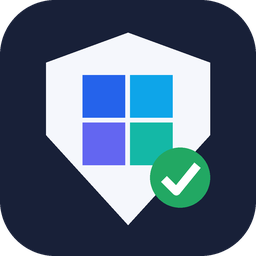
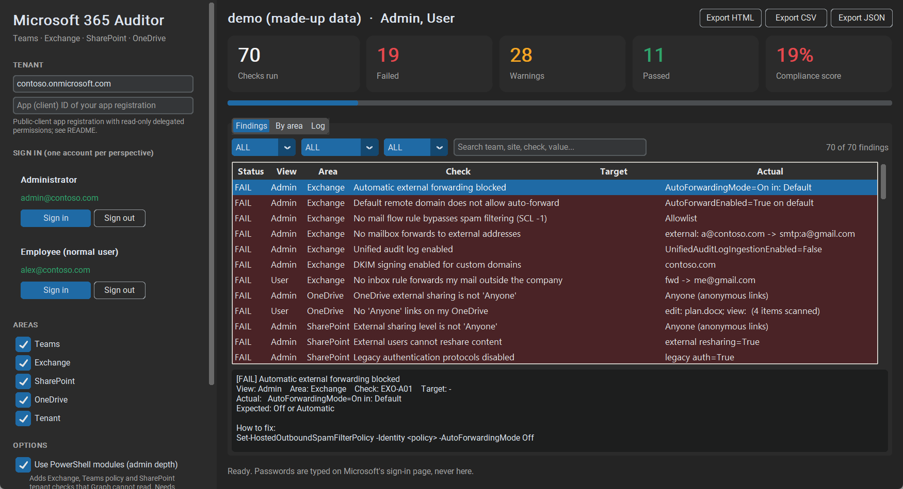
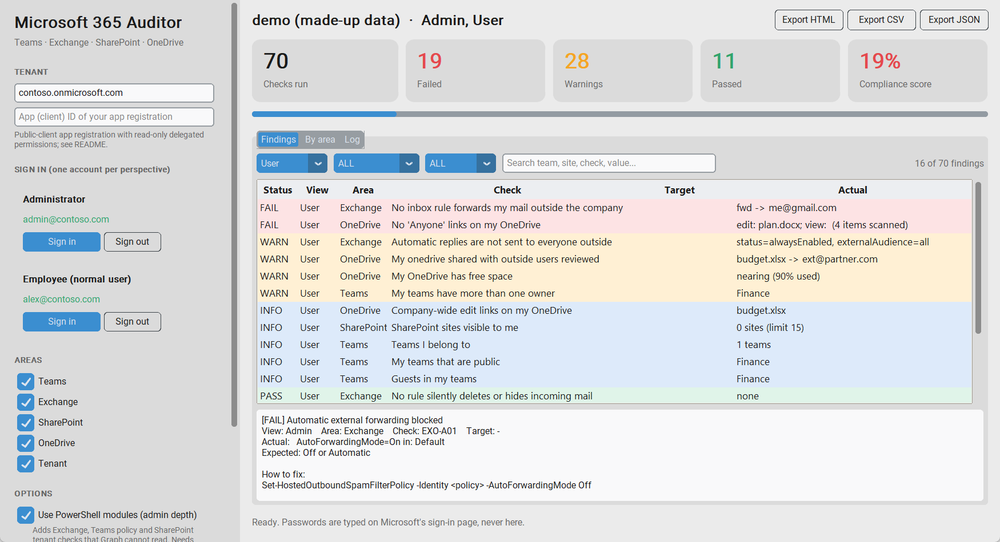

<p align="center">
  
</p>

<h1 align="center">🛡️ Microsoft 365 Config Auditor</h1>

<p align="center">
  <b>See your Microsoft 365 tenant the way an administrator <i>and</i> an ordinary employee see it.</b><br>
  Read-only security configuration checks for 💬 Teams, 📧 Exchange Online, 📁 SharePoint and ☁️ OneDrive, in a modern desktop GUI.
</p>

<p align="center">
  
  
  
  
  
  
</p>

<p align="center">
   
</p>
<p align="center"><sub>Screenshots use <b>made-up demo data</b> (<code>tools/make_screenshot.py</code>), not a real tenant.</sub></p>

> 🚧 **Status:** every check is covered by offline tests against canned Graph and PowerShell data, but the tool has **not yet run against a live Microsoft 365 tenant**. Try it in a test or developer tenant first and report anything that differs; some Graph endpoints and permission requirements can behave differently in your tenant.

## 📑 Contents

[✨ Features](#-features) · [🧭 Two perspectives](#-two-perspectives) · [🚀 Quick start](#-quick-start) · [🔑 Permissions](#-permissions) · [🧩 PowerShell depth](#-powershell-depth) · [✅ Checks reference](#-checks-reference) · [🔐 Safety](#-safety) · [🚧 Limits](#-limits) · [🧪 Tests](#-tests) · [❓ FAQ](#-faq) · [📌 Roadmap](#-roadmap) · [📄 License](#-license)

## ✨ Features

| | |
|---|---|
| 👑 **Admin view** | Tenant-wide settings: sharing, guest access, mail flow, policies, Conditional Access |
| 👤 **Employee view** | What a normal account can see and has set up: inbox rules, shared files, teams, calendar |
| 💬 **Teams** | Team inventory (ownerless, public, guests, labels), creation limits, meeting and external-access policy |
| 📧 **Exchange Online** | SPF / DMARC / DKIM, auto-forwarding, mail-flow rules, audit log, anti-phishing, SMTP AUTH |
| 📁 **SharePoint** | External sharing level, link defaults, expiry, "Everyone" claim, per-site sharing |
| ☁️ **OneDrive** | Sharing level, sync restrictions, retention, inactive and full accounts, "Anyone" links |
| 🏢 **Tenant** | Guest invitations, MFA and legacy-auth blocking, Global Admin count |
| 🖥️ **Modern GUI** | Dark / light themes, summary cards, filters by view / area / status, search, fix instructions |
| 📦 **Reports** | HTML, CSV and JSON export with the tenant data HTML-escaped |
| ⌨️ **CLI** | Headless runs with device-code sign-in |

### 🚦 Status legend

🔴 **FAIL** needs fixing · 🟠 **WARN** review · 🔵 **INFO** for awareness · ⚪ **MANUAL** check it by hand · 🟣 **ERROR** the check itself failed · 🟢 **PASS** compliant

## 🧭 Two perspectives

```
 👑 Administrator sign-in ──► tenant configuration ──┐
                                                      ├──►  🛡️ findings tagged Admin / User  ──►  📦 HTML · CSV · JSON
 👤 Employee sign-in      ──► what a normal user sees ┘
```

You sign in **twice**, with two different accounts: an administrator and an ordinary employee. Each sign-in requests only the read-only permissions its own checks need. When the employee account cannot read something, the tool reports that (instead of hiding it), so you can see what the company really exposes to normal users. You can also run just one perspective.

Microsoft's sign-in page handles the password and MFA. **This tool never sees a password**, and tokens stay in memory (no cache file is written).

## 🚀 Quick start

### 1️⃣ Register an app (once per tenant)
1. Entra admin center > **App registrations** > **New registration** (*this organizational directory only*).
2. **Authentication**: add platform **Mobile and desktop applications** with redirect URI `http://localhost`, and set **Allow public client flows** to *Yes* (needed for device-code sign-in).
3. **API permissions**: add the read-only delegated permissions from [🔑 Permissions](#-permissions) for the areas you will audit, then **Grant admin consent**.
4. Copy the **Application (client) ID** and your tenant domain.

### 2️⃣ Run the GUI
```powershell
pip install -r requirements.txt
python m365_audit_gui.py
```
1. Enter the **tenant** and **client ID**.
2. Click **Sign in** under 👑 *Administrator* and/or 👤 *Employee*.
3. Choose the areas, then **Run audit**.
4. Use the filters to switch between **Admin** and **User** findings, **By area** for the split, and **Export** for a report.

### ⌨️ Command line
```powershell
python m365_audit_cli.py --tenant contoso.onmicrosoft.com --client-id <app-id> --admin --user
python m365_audit_cli.py --tenant contoso.onmicrosoft.com --client-id <app-id> --user --areas OneDrive,Exchange
```
Device-code sign-in is the default (`--browser` for an interactive browser). Writes `m365_audit.html`, `.csv` and `.json`.

## 🔑 Permissions

All permissions are **delegated** Microsoft Graph and **read-only**.

| | Permissions |
|---|---|
| 👑 **Admin** | `Group.Read.All` · `Team.ReadBasic.All` · `TeamSettings.Read.All` · `TeamMember.Read.All` · `TeamworkAppSettings.Read.All` · `Directory.Read.All` · `Policy.Read.All` · `Organization.Read.All` · `RoleManagement.Read.Directory` · `SharePointTenantSettings.Read.All` · `Sites.Read.All` · `Reports.Read.All` |
| 👤 **User** | `User.Read` · `Team.ReadBasic.All` · `Mail.Read` · `MailboxSettings.Read` · `Calendars.Read` · `Sites.Read.All` · `Files.Read` |

The administrator permissions need **admin consent**; employees can consent to some user permissions only if your tenant's consent settings allow it. The administrator account also needs a role that can read these settings (for example *Global Reader* plus the Teams, Exchange and SharePoint reader or administrator roles).

## 🧩 PowerShell depth

Microsoft Graph does not expose several settings (Exchange organisation config, Teams policies, some SharePoint tenant settings). With **Use PowerShell modules** enabled, the tool runs a fixed list of read-only `Get-*` cmdlets and signs the administrator in through each module's own prompt:

```powershell
Install-Module ExchangeOnlineManagement, MicrosoftTeams, Microsoft.Online.SharePoint.PowerShell -Scope CurrentUser
```
If PowerShell or a module is missing, the affected checks show as ⚪ `MANUAL` with what to run instead of failing the audit. A test verifies that no non-`Get-` cmdlet is ever executed. The SharePoint module requires Windows PowerShell 5.1.

## ✅ Checks reference

<details>
<summary><b>💬 Teams</b> (admin <code>TEAMS-A*</code>, employee <code>TEAMS-U*</code>)</summary>

| ID | Check | View |
|---|---|---|
| TEAMS-A01 / A02 | Group creation restricted; guests cannot own groups | 👑 |
| TEAMS-A03 | Resource-specific consent for apps reviewed | 👑 |
| TEAMS-A04 / A05 | Every team has an owner; at least two owners | 👑 |
| TEAMS-A06 / A07 / A08 | Public teams, guest-containing teams, sensitivity labels | 👑 |
| TEAMS-A09 | Guests cannot create or delete channels | 👑 |
| TEAMS-A10..A15 | Consumer external access, federation, anonymous join, lobby, PSTN bypass, third-party storage (PowerShell) | 👑 |
| TEAMS-U01..U04 | Teams I belong to, public teams, guests in my teams, single-owner teams | 👤 |
</details>

<details>
<summary><b>📧 Exchange Online</b> (admin <code>EXO-A*</code>, employee <code>EXO-U*</code>)</summary>

| ID | Check | View |
|---|---|---|
| EXO-A20 / A21 | SPF ends in `-all`; DMARC enforces quarantine or reject | 👑 |
| EXO-A01 / A02 / A04 | Auto-forwarding blocked; default remote domain; mailbox forwarding to external addresses (PowerShell) | 👑 |
| EXO-A03 / A05 | Mail-flow rules: no SCL -1 bypass; redirects reviewed (PowerShell) | 👑 |
| EXO-A06..A10 | SMTP AUTH, modern auth, mailbox audit, Customer Lockbox, unified audit log (PowerShell) | 👑 |
| EXO-A11..A15 | Anti-phishing, Safe Links / Attachments, malware filter, DKIM, OWA storage providers (PowerShell) | 👑 |
| EXO-U01 / U02 | Inbox rules forwarding outside; rules that silently delete or hide mail | 👤 |
| EXO-U03 / U04 | Automatic replies to everyone outside; calendar shared outside | 👤 |
</details>

<details>
<summary><b>📁 SharePoint</b> (admin <code>SP-A*</code>, employee <code>SP-U*</code>)</summary>

| ID | Check | View |
|---|---|---|
| SP-A01 | External sharing level is not "Anyone" | 👑 |
| SP-A02 / A03 | No external resharing; legacy authentication off | 👑 |
| SP-A04 / A05 | Domain restrictions; idle session sign-out | 👑 |
| SP-A06..A12 | Default link type and permission, anonymous expiry, guest expiry, e-mail verification, infected-file download, "Everyone" claim (PowerShell) | 👑 |
| SP-A13 / A14 | Self-service site creation; sites allowing "Anyone" links | 👑 |
| SP-U-01..03 | "Anyone" links, outside sharing, company-wide edit links on sites I can access | 👤 |
</details>

<details>
<summary><b>☁️ OneDrive</b> (admin <code>OD-A*</code>, employee <code>OD-U*</code>)</summary>

| ID | Check | View |
|---|---|---|
| OD-A01 | OneDrive sharing level is not "Anyone" (PowerShell) | 👑 |
| OD-A02 | Sync only from managed devices | 👑 |
| OD-A03 | Retention after a user leaves | 👑 |
| OD-A04 / A05 | Inactive accounts; accounts nearly out of storage | 👑 |
| OD-U01 | My OneDrive has free space | 👤 |
| OD-U-01..03 | "Anyone" links, outside sharing, company-wide edit links in my OneDrive | 👤 |
</details>

<details>
<summary><b>🏢 Tenant</b> (<code>TEN-A*</code>)</summary>

| ID | Check |
|---|---|
| TEN-A01 / A02 | Guest invitations limited; guest access restricted |
| TEN-A03 / A07 | Users cannot create tenants or register apps |
| TEN-A04 / A05 | MFA for all users; legacy authentication blocked (Conditional Access or security defaults) |
| TEN-A06 | Global Administrator count is 2 to 4 |
</details>

## 🔐 Safety

- 🔒 **Read-only:** only Graph `GET` requests and `Get-*` cmdlets. Nothing in the tenant is changed.
- 🔑 **No secrets handled or stored:** sign-in happens on Microsoft's pages; tokens live in memory only.
- 📏 **Bounded scans:** the employee view samples a limited number of files and sites (defaults: 150 items in OneDrive, 15 sites × 60 items), so very large tenants are sampled, not exhaustively scanned.
- 🗂️ **Reports are sensitive:** they list teams, files and addresses, so treat exported files as confidential.

## 🚧 Limits

- Not yet validated on a live tenant (see the status note above).
- Employee-view results depend on the consent your tenant grants to normal users; denied calls appear as 🟠 `WARN` ("access denied for this account").
- The OneDrive "Anyone link" scan relies on the item `shared` facet; SharePoint libraries are checked item by item within the sample cap.
- Mailbox delegation, retention and many Defender policies are not covered. This is a focused, CIS-inspired set, not a full benchmark.
- OneDrive usage reports may be anonymised by tenant privacy settings; only counts are used.

## 🧪 Tests

```powershell
python tests/test_checks.py
```
Runs every check against canned Graph and PowerShell data (no network or tenant), plus the Graph client's paging and retry, report escaping and the GUI logic.

## ❓ FAQ

<details><summary><b>Do I need two accounts?</b></summary>
Only for both views. Sign in with just an administrator for tenant settings, or just an employee to see what a regular user can reach.
</details>

<details><summary><b>Why do I need my own app registration?</b></summary>
It keeps consent under your control: you decide which read-only permissions are granted in your tenant, and no third-party app ID is used.
</details>

<details><summary><b>Can it change or fix settings?</b></summary>
No. It only reads, and every finding includes the remediation steps for you to apply.
</details>

<details><summary><b>Why are some checks marked MANUAL?</b></summary>
They need the Exchange, Teams or SharePoint PowerShell modules (or a permission that was denied). Install the modules and enable the PowerShell option, or check them in the admin centers.
</details>

## 📌 Roadmap

- [ ] Validate against developer tenants and fix any API differences
- [ ] Windows executable via PyInstaller (like a one-file release)
- [ ] More Defender for Office 365 and retention checks
- [ ] Optional per-check enable/disable and a baseline file

## 📄 License

[MIT](LICENSE)
